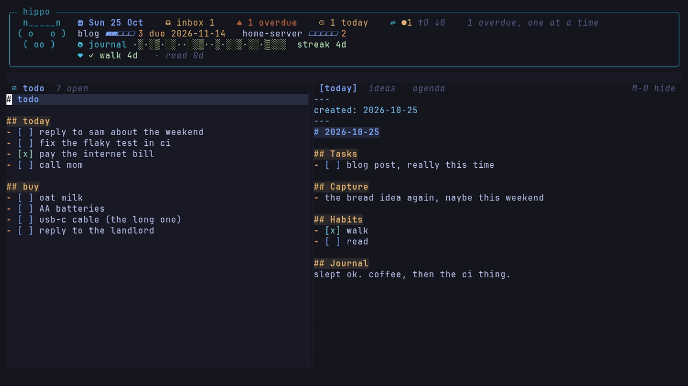

# hippo.nvim

```
 n_____n
( ^   ^ )   a front page for your notes, inside nvim
 ( oo )
```

A dashboard for all you ADHD brain-damaged dudes like me.

If you have ADHD, you know the deal: if you don't see something, you forget it. Or you
just can't keep track of what you should do and what you already did. Or maybe you
just want to manage your notes, you used Obsidian, and you wanted a better dashboard
in Neovim. Then this can help.

I used to write my stuff in Neovim with the
[obsidian.nvim](https://github.com/obsidian-nvim/obsidian.nvim) plugin. It was great:
links, search, templates. But I wanted a first page, a dashboard where I see everything
in one place: today's journal, todos, backlog, tasks and so on. My todo, my ideas, the
tasks with a date, the inbox I didn't file, they were all in different notes, and I had
to remember to open each one. I use Neovim daily, so I made hippo, with some help from
Claude. It turns the first tab into a dashboard with the things I need in front of me.
I write in the other tabs and jump back to the dashboard with one key.

hippo doesn't replace obsidian.nvim, they work together. obsidian.nvim does the notes,
hippo does the front page.



It works with any folder of markdown notes. It fits best with a PARA style vault
(inbox, projects, areas, resources, archives) and daily notes, but you can rename every
folder.

## What you need

- Neovim 0.11 or newer
- A Nerd Font, for the icons
- [obsidian.nvim](https://github.com/obsidian-nvim/obsidian.nvim) for links, search and templates (optional, but they go well together)
- [render-markdown.nvim](https://github.com/MeanderingProgrammer/render-markdown.nvim) if you want nicer looking markdown (optional)
- `git`, for the sync part
- [Claude Code](https://docs.claude.com/en/docs/claude-code) (the `claude` command), for the Claude window

## Install

With [lazy.nvim](https://github.com/folke/lazy.nvim):

```lua
{
    "alipourhabibi/hippo.nvim",
    lazy = false,
    opts = {
        path = "~/notes",
    },
}
```

Don't skip `lazy = false`. hippo has to load before Neovim starts, so it can open the
dashboard when you open Neovim inside your vault.

## Config

You only need `path`. Here's everything, with the defaults:

```lua
{
    path = "~/notes",
    keys = {
        dashboard = "<M-b>",
        claude = "<M-c>",
        capture = "<M-n>",
        add_tab = "<M-a>",
    },
    -- open tasks with this tag count for projects and show in the agenda
    task_tag = "#task",
    dashboard = {
        main = "today",       -- the note on the left
        tabs = { "agenda" },  -- the tabs on the right
        header = "box",       -- "box", "line" or "none"
        mascot = true,        -- the hippo in the box
        main_width = 0.45,
    },
    -- short names for notes you use a lot
    notes = {},
    -- where capture can write
    capture = { "today" },
    daily = {
        folder = "daily",
        template = "templates/daily.md",
    },
    inbox = { "0-Inbox" },
    projects = "1-Projects",
    sync_message = "vault sync %Y-%m-%d %H:%M",
    claude_cmd = { "claude" },
    claude_size = { width = 0.9, height = 0.45 },
}
```

Mine looks something like this:

```lua
opts = {
    path = "~/obsidian/vault",
    notes = {
        todo = "2-Areas/routine/todo.md",
        ideas = "2-Areas/routine/ideas.md",
        backlog = "2-Areas/routine/backlog.md",
    },
    dashboard = {
        main = "todo",
        tabs = { "today", "ideas", "backlog", "agenda" },
    },
    capture = { "ideas", "today" },
    inbox = { "0-Inbox", "inbox-notes" },
    sync_message = "Last Sync: %Y-%m-%d %H:%M (Laptop)",
}
```

### What you can put in main, tabs and capture

They all take the same kind of entry:

- `"today"`: today's daily note
- `"agenda"`: the task list built from your whole vault (not for capture)
- a name from `notes`, like `"todo"`
- any md file in your vault, like `"3-Resources/books/some-book.md"`. The tab gets
  the file's name.

So adding a tab is one line, and removing one is deleting that line.

## Keys

Keys are written the Neovim way: `<M-b>` is Alt+b, `<CR>` is Enter, `<C-h>` is Ctrl+h.

| key | what it does |
|---|---|
| `<M-b>` | go to the dashboard, press it again to go back to where you were |
| `<M-1>` to `<M-9>` | on the dashboard, show that tab on the right |
| `<M-0>` | on the dashboard, hide the right pane, press it again to bring it back |
| `<M-a>` | add the note you're in as a tab, until you close Neovim |
| `<M-n>` | capture a thought, `Tab` switches where it goes |
| `<M-c>` | open or hide Claude |

You can Move between the two panes like any
split, with `Ctrl+w h` and `Ctrl+w l` (or `Ctrl+h` / `Ctrl+l` if you use
vim-tmux-navigator). If you close the right pane with `:q`, any `Alt+<number>` brings
it back.

In the agenda and the header:

| key | what it does |
|---|---|
| `<CR>` | open the task's note, right on its line |
| `x` | mark the task done, or undo it |
| `C` | carry yesterday's open tasks to today |
| `S` | sync your vault with git (it asks first) |
| `r` | refresh |
| `q` | go back to the last tab |
| `?` | show the keys |

Everything is also a command: `:Hippo` plus one of `toggle`, `refresh`, `help`,
`carry`, `sync`, `capture`, `claude`, `addtab`, `side` (hide or show the right pane),
or `tab <n>` (show tab n on the right).

## The dashboard

```
╭─ hippo ──────────────────────────────────────────────────────────────────────╮
│  n_____n    Sun 25 Oct   inbox 1   1 overdue   1 today   ●1 ↑0 ↓0              │
│ ( o   o )  blog ▰▰▱▱▱ 3 due 2026-11-14   garden ▱▱▱▱▱ 2                       │
│  ( oo )     journal ·░·▒▒·░░··▒░░··▒·░▒▒·░░·  streak 3d                         │
│             · walk 3d   · read 2d                                              │
╰──────────────────────────────────────────────────────────────────────────────╯
  todo  5 open              │ [today]  ideas  agenda                  M-0 hide
 # Todo                     │ # 2026-10-25
 - [ ] call the bank        │
 - [ ] fix the bike         │ ## Tasks
```

### The header

| part | what it shows |
|---|---|
| inbox | notes in your `inbox` folders |
| overdue / today | open tasks due before today, or today |
| git | `●` changed, `↑` not pushed, `↓` not pulled |
| projects | each folder in `projects`, done vs open `#task` tasks, and `deadline:` if set |
| journal | last 28 days, darker = you wrote more, plus your streak |
| habits | streaks from `## Habits` in your daily template |

Too much? `header = "line"` or `header = "none"`. No hippo? `mascot = false`.

## Tasks

```markdown
- [ ] call the landlord #task
- [ ] pay rent #task 📅 2026-10-30 ⏫
```

Only `#task` tasks count (so long checklists don't). `📅` is the due date, `⏫` the
priority, same as [Obsidian Tasks](https://publish.obsidian.md/tasks/), so your phone
gets them too.

## The rest

- **Agenda:** overdue, today, next 7 days, and `#task` tasks with no date. Enter opens one, `x` marks it done.
- **Carry over (`C`):** yesterday's open tasks go to today's `## Tasks`, the old ones get `[>]`.
- **Habits:** put `## Habits` with `- [ ] walk` style items in your daily template.
- **Capture (`Alt+n`):** type, Enter, done. `Tab` picks the note.
- **Claude (`Alt+c`):** Claude Code in a float, inside your vault. Hiding it keeps the chat.
- **Sync (`S`):** asks, then commits, pulls with rebase and pushes. Stops on any git error.
- **Today's note:** if it doesn't exist yet, hippo fills it from your template but only saves when you do.

hippo only writes to your notes when you press `x`, `C`, `Alt+n` or `S`. Everything else
is just drawn by Neovim. Colors link to normal highlight groups (`HippoTitle`,
`HippoHeat` and so on), so your colorscheme picks them.

## License

MIT
